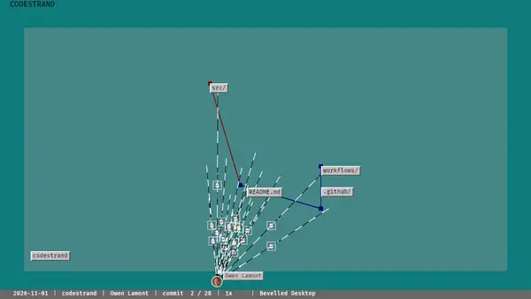

# Codestrand


A Git history visualiser with persistent file positions, gliding contributors and
animated diff fragments. Preview a local repository or export numbered PNG frames or
video.



Watch the [feature tour on YouTube](https://youtu.be/gmueXAHnvAE).

**Status: layout study.** Video export uses your installed FFmpeg.
Licensed MIT OR Apache-2.0.

Diff samples use Bevy's bundled Fira Mono font (OFL-1.1); see
[third-party notices](THIRDPARTY.txt).

[User documentation](https://codestrand.pages.dev/) covers installation, Git
history, playback, export and contributor avatars.

## Install

```sh
uv tool install codestrand
```

Also available through `cargo install --locked codestrand`,
`npm install --global @owenlamont/codestrand` and
[GitHub releases](https://github.com/owenlamont/codestrand/releases).

## Quick start

```sh
codestrand preview
codestrand preview --repository /path/to/repository
```

The first command plays the built-in demo. Escape closes the window.
See [Contributing](https://github.com/owenlamont/codestrand/blob/main/CONTRIBUTING.md) for development setup and checks.
