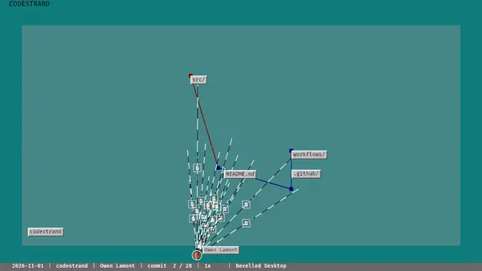

# Codestrand

Watch a Git repository take shape over time. Files keep persistent positions while
contributors glide above the directory graph. Each commit connects a contributor to
all affected files; diff fragments show additions and removals.

Codestrand is a **layout study**, with seven steady themes, labels, contributor
portraits and a mostly planar scene. Preview and export share a repeatable
simulation, including playback of multiple repositories. Export writes PNG frames or
streams video to your installed FFmpeg.

## Start here

1. [Install Codestrand](getting-started/installation.md).
2. [Play the demo or your repository](getting-started/quickstart.md).
3. Adjust [playback and camera controls](playback.md).
4. [Export frames](export.md) or set up [contributors and avatars](contributors.md).

Use [Git history import](history.md) for revisions and cache behaviour, and
[troubleshooting](troubleshooting.md) for platform and configuration problems.

## Acknowledgements

Codestrand is licensed MIT OR Apache-2.0. Thanks to
[Material Icon Theme](https://github.com/material-extensions/vscode-material-icon-theme)
for file icons (MIT), [Bevy](https://bevy.org/) for rendering,
[resvg](https://github.com/linebender/resvg) for SVG rasterisation,
[gix](https://github.com/GitoxideLabs/gitoxide) for Git access and
[Gource](https://gource.io/) for inspiration.
